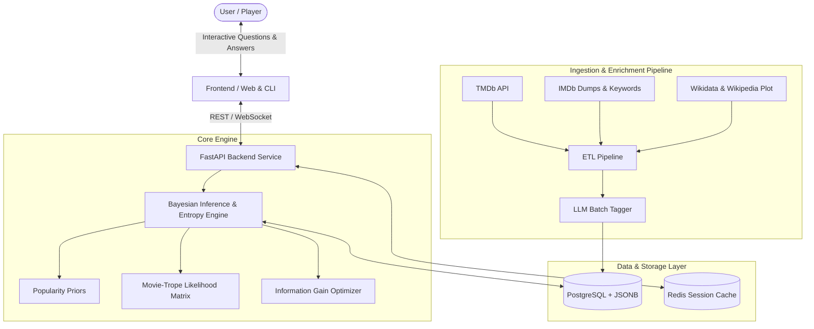

# Movienator: System Architecture Blueprint

## 1. Executive Summary

**Movienator** is an intelligent, probabilistic 20-questions guessing engine designed specifically for Indian Cinema (spanning Bollywood, Tollywood, Kollywood, Mollywood, Sandalwood, and regional cinema). 

Unlike classical hard-coded decision trees that break when a user misremembers a detail, Movienator uses **Bayesian Active Learning**, **Information Theory (Shannon Entropy)**, and a **continuous crowdsourced learning loop** to deduce the user's movie in under 20 questions.



---

## 2. Core System Components

### A. Frontend Layer (Player Experience)
* **Web UI (Next.js / Tailwind CSS or Lightweight HTML5):**
  * Displays dynamic character/genie avatar reactions (neutral, thinking, confident, celebratory, stumped).
  * 5 response buttons:
    * `Yes`
    * `Probably / Partially`
    * `Don't Know / Neutral`
    * `Probably Not`
    * `No`
  * Real-time confidence progress bar (0% to 100%).
  * Guess modal with movie poster, year, cast, and director.
  * Crowdsourcing modal: *"I was thinking of [Movie Name]"* + *"What question distinguishes your movie?"*

### B. Application & API Layer (FastAPI / Node.js)
* **Session Manager:** Ephemeral game sessions stored in Redis with a 30-minute TTL.
  * State tracks: `session_id`, `history` of asked questions, current posterior probability vector across candidates.
* **Endpoints:**
  * `POST /api/game/start`: Initializes session with popularity-weighted priors; returns Question #1.
  * `POST /api/game/answer`: Accepts answer (1 to 5); updates probabilities; returns next question or triggers guess.
  * `POST /api/game/confirm`: Player confirms if guess is right or wrong.
  * `POST /api/game/teach`: Receives player correction, adding new movie or trope to database.

### C. The Core Movienator Engine
* **Bayesian Probability Updater:** Computes posterior probabilities:
  $$P(C_i \mid a_t, q_t) = \frac{P(C_i) \cdot P(a_t \mid C_i, q_t)}{\sum_j P(C_j) \cdot P(a_t \mid C_j, q_t)}$$
* **Information Gain Question Selector:** Selects the question $q^*$ that maximizes entropy reduction (aims for a 50/50 probability mass split).
* **Noise & Ambiguity Absorber:** Smooths likelihoods so no candidate is ever multiplied by 0, preventing accidental elimination when users make mistakes.

### D. Data & Storage Layer
* **PostgreSQL:**
  * `movies`: Core metadata (id, title, year, language, director, cast, popularity, poster_url).
  * `questions`: Master pool of questions/tropes with category and global weight.
  * `movie_attributes`: High-performance sparse matrix or JSONB storing `(movie_id, question_id, truth_value, confidence_count)`.
  * `game_logs`: Telemetry tracking question paths, success rates, and user corrections.
* **Redis:** In-memory session store for lightning-fast sub-5ms turn responses.

---

## 3. Database Schema Design

```sql
-- Movies Table
CREATE TABLE movies (
    id VARCHAR(64) PRIMARY KEY,
    title VARCHAR(255) NOT NULL,
    year INT NOT NULL,
    language VARCHAR(32) NOT NULL,
    industry VARCHAR(64) NOT NULL,
    director VARCHAR(255),
    lead_cast JSONB DEFAULT '[]',
    popularity_score FLOAT DEFAULT 1.0,
    tmdb_id INT UNIQUE,
    imdb_id VARCHAR(32) UNIQUE,
    poster_path VARCHAR(255),
    created_at TIMESTAMP WITH TIME ZONE DEFAULT NOW()
);

-- Questions / Tropes Table
CREATE TABLE questions (
    id VARCHAR(64) PRIMARY KEY,
    question_text VARCHAR(512) NOT NULL,
    category VARCHAR(64) NOT NULL, -- 'industry', 'era', 'trope', 'character', 'setting', 'cast'
    weight FLOAT DEFAULT 1.0,
    times_asked INT DEFAULT 0,
    is_active BOOLEAN DEFAULT TRUE,
    created_at TIMESTAMP WITH TIME ZONE DEFAULT NOW()
);

-- Movie-Attribute Matrix (Crowdsourced and Machine-tagged)
CREATE TABLE movie_attributes (
    movie_id VARCHAR(64) REFERENCES movies(id) ON DELETE CASCADE,
    question_id VARCHAR(64) REFERENCES questions(id) ON DELETE CASCADE,
    score FLOAT NOT NULL CHECK (score >= 0.0 AND score <= 1.0),
    yes_votes INT DEFAULT 1,
    no_votes INT DEFAULT 0,
    updated_at TIMESTAMP WITH TIME ZONE DEFAULT NOW(),
    PRIMARY KEY (movie_id, question_id)
);

-- Index for fast lookup by question
CREATE INDEX idx_movie_attr_question ON movie_attributes(question_id);
```

---

## 4. Scaling to 50,000+ Indian Films

When scaling from 1,000 films to 50,000+ films:
1. **Hierarchical Pruning (Coarse-to-Fine):**
   * Early questions target high-level partitions (e.g. Era: Pre-2000 vs Post-2000; Language: Hindi vs South Indian; Tone: Masala/Action vs Romance/Comedy).
   * After 4–5 questions, the active candidate pool shrinks from 50,000 to < 1,500.
2. **Matrix Sparsity:**
   * An in-memory sparse float matrix (or NumPy/PyTorch tensor) allows vector-accelerated Bayesian updates across 50,000 entities in < 2ms.
3. **Popularity Prior Capping:**
   * 90% of real players think of top 2,000 films. Prior probabilities are weighted by log-normalized IMDb vote counts, ensuring questions remain relevant to popular culture while still allowing obscure films to be reached if specific niche tropes are confirmed.
