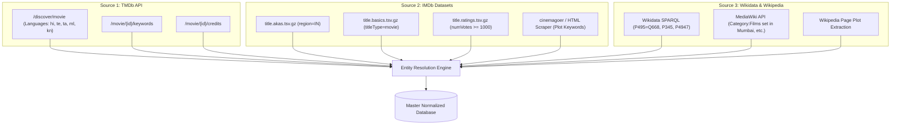

# Movienator: Data Acquisition & ETL Pipeline

## 1. Overview & Data Sources

To power Movienator across Bollywood and major regional Indian film industries, we ingest and cross-reference data from three primary sources:



---

## 2. Source 1: The Movie Database (TMDb) API

TMDb provides a free, structured JSON API with high coverage of Indian films released from 1980 to the present.

### 2.1 Key Endpoints & Parameters

#### A. Discovering Indian Movies
* **Endpoint:** `GET https://api.themoviedb.org/3/discover/movie`
* **Query Parameters:**
  * `with_original_language`: Pipe-separated ISO-639-1 codes: `hi|te|ta|ml|kn|bn|mr|pa`
  * `vote_count.gte`: `10` (filters out test entries and student films)
  * `sort_by`: `popularity.desc` or `vote_count.desc`
  * `primary_release_date.gte` / `.lte`: Used to partition queries by 5-year windows to bypass TMDb's 500-page pagination limit.

#### B. Fetching Deep Attributes (Single-Request Batching)
TMDb supports `append_to_response` to fetch keywords, credits, and external IDs in a single HTTP request:
* **Endpoint:** `GET https://api.themoviedb.org/3/movie/{movie_id}?api_key=KEY&append_to_response=keywords,credits,external_ids`
* **Yields:**
  * `keywords.keywords`: Array of trope tags (e.g., `[{"id": 9715, "name": "superhero"}, {"id": 155790, "name": "undercover cop"}]`).
  * `credits.cast`: Top actors and character names.
  * `credits.crew`: Director, writer, music composer (e.g. A. R. Rahman).
  * `external_ids.imdb_id`: The IMDb `tt...` identifier (critical for Entity Resolution).

### 2.2 Python Harvester for TMDb

```python
import os
import time
import requests
from typing import Generator, Dict, Any

TMDB_API_KEY = os.getenv("TMDB_API_KEY", "YOUR_KEY_HERE")
BASE_URL = "https://api.themoviedb.org/3"

def fetch_indian_movies(language="hi", min_votes=50) -> Generator[Dict[str, Any], None, None]:
    headers = {"Authorization": f"Bearer {TMDB_API_KEY}"} if len(TMDB_API_KEY) > 40 else {}
    params = {
        "api_key": TMDB_API_KEY,
        "with_original_language": language,
        "vote_count.gte": min_votes,
        "sort_by": "popularity.desc",
        "page": 1
    }
    
    resp = requests.get(f"{BASE_URL}/discover/movie", params=params, headers=headers).json()
    total_pages = min(resp.get("total_pages", 1), 500)
    
    for page in range(1, total_pages + 1):
        params["page"] = page
        page_data = requests.get(f"{BASE_URL}/discover/movie", params=params, headers=headers).json()
        for movie in page_data.get("results", []):
            m_id = movie["id"]
            # Fetch enriched details with keywords and IMDb ID
            detail_url = f"{BASE_URL}/movie/{m_id}"
            detail_params = {"api_key": TMDB_API_KEY, "append_to_response": "keywords,credits,external_ids"}
            detail = requests.get(detail_url, params=detail_params, headers=headers).json()
            yield detail
            time.sleep(0.05) # Respect rate limits
```

---

## 3. Source 2: IMDb Non-Commercial Datasets & Keywords

IMDb provides bulk daily TSV gzip archives for non-commercial research at [datasets.imdbws.com](https://datasets.imdbws.com/).

### 3.1 Filtering Indian Movies from TSV Dumps
1. **`title.akas.tsv.gz`**: Contains regional distribution logs.
   * Filter: `region == 'IN'` or `language in ('hi', 'te', 'ta', 'ml', 'kn', 'bn', 'mr')`.
   * Collect the matching `titleId` (`tconst`).
2. **`title.basics.tsv.gz`**:
   * Filter: `titleType == 'movie'` and `tconst in indian_title_ids`.
   * Extracts: `primaryTitle`, `startYear`, `genres`.
3. **`title.ratings.tsv.gz`**:
   * Extracts `numVotes` and `averageRating` (essential for setting candidate prior probabilities).

### 3.2 Extracting IMDb Plot Keywords via Cinemagoer

```python
from imdb import Cinemagoer

ia = Cinemagoer()

def get_imdb_keywords(tconst: str) -> list[str]:
    # Strip 'tt' prefix if present
    imdb_numeric_id = tconst.replace("tt", "")
    movie = ia.get_movie(imdb_numeric_id)
    ia.update(movie, 'keywords')
    return movie.get('keywords', [])

# Example:
# keywords = get_imdb_keywords("tt0073707") # Sholay (1975)
# Returns: ['bandit', 'revenge', 'train robbery', 'friendship', 'mercenary', 'amputation']
```

---

## 4. Source 3: Wikidata SPARQL & Wikipedia

Wikidata acts as the universal linking graph connecting TMDb, IMDb, and Wikipedia.

### 4.1 Wikidata SPARQL Query for Indian Cinema
You can submit this query to `https://query.wikidata.org/sparql`:

```sparql
SELECT ?film ?filmLabel ?year ?imdbId ?tmdbId ?directorLabel ?wikiUrl WHERE {
  # Instance of Film
  ?film wdt:P31 wd:Q11424.
  
  # Country of origin = India (Q668)
  ?film wdt:P495 wd:Q668.
  
  # Release year
  OPTIONAL { ?film wdt:P577 ?pubDate. BIND(YEAR(?pubDate) AS ?year) }
  
  # External IDs
  OPTIONAL { ?film wdt:P345 ?imdbId. }     # IMDb ID (e.g. tt0073707)
  OPTIONAL { ?film wdt:P4947 ?tmdbId. }   # TMDb Movie ID
  OPTIONAL { ?film wdt:P57 ?director. }   # Director
  
  # English Wikipedia Article Link
  OPTIONAL {
    ?wikiUrl schema:about ?film;
             schema:isPartOf <https://en.wikipedia.org/>.
  }

  SERVICE wikibase:label { bd:serviceParam wikibase:language "en". }
}
LIMIT 20000
```

### 4.2 Harvesting Wikipedia Categories for Tropes
Wikipedia's category system is a goldmine for pre-tagged tropes:
* `Category:Films_set_in_Mumbai`
* `Category:Indian_films_featuring_a_double_role`
* `Category:Twins_in_Indian_films`
* `Category:Films_about_cricket_in_India`
* `Category:Indian_masala_films`

```python
import requests

def get_category_films(category_title: str) -> list[str]:
    url = "https://en.wikipedia.org/w/api.php"
    params = {
        "action": "query",
        "list": "categorymembers",
        "cmtitle": f"Category:{category_title}",
        "cmlimit": 500,
        "format": "json"
    }
    headers = {"User-Agent": "MovienatorETL/1.0 (academic research)"}
    resp = requests.get(url, params=params, headers=headers).json()
    members = resp.get("query", {}).get("categorymembers", [])
    # Return page titles in this trope category
    return [m["title"] for m in members if m["ns"] == 0]
```

---

## 5. Entity Resolution Pipeline

Because titles can have spelling variations (e.g., *Devdas* vs *Deva Daasu*, *K.G.F: Chapter 1* vs *KGF 1*), we use a **3-tier deterministic resolution graph**:

```
Tier 1: Direct ID Match (Exact)
  If TMDb external_ids.imdb_id == IMDb tconst == Wikidata P345:
    -> PERFECT MATCH (Confidence: 1.0)

Tier 2: Wikidata Sitelink to Wikipedia
  If Wikidata item links to en.wikipedia.org/wiki/{Title}:
    -> EXACT WIKIPEDIA ARTICLE LINK (Confidence: 0.99)

Tier 3: Fuzzy Transliteration Match (Fallback)
  For entries lacking IDs:
    NormalizedTitle(A) == NormalizedTitle(B) AND ReleaseYear(A) == ReleaseYear(B)
    -> MATCH (Confidence: 0.92)
```

---

## 6. Output Clean Record Format

Each resolved movie is stored in the database ready for the Akinator engine:

```json
{
  "id": "sholay_1975",
  "title": "Sholay",
  "year": 1975,
  "language": "hi",
  "industry": "Bollywood",
  "director": "Ramesh Sippy",
  "lead_cast": ["Amitabh Bachchan", "Dharmendra", "Sanjeev Kumar", "Hema Malini", "Amjad Khan"],
  "popularity_score": 0.98,
  "tmdb_id": 10757,
  "imdb_id": "tt0073707",
  "wikipedia_title": "Sholay",
  "raw_keywords": [
    "bandit", "revenge", "train robbery", "friendship", "mercenary", 
    "amputation", "dacoit", "rural india", "classic cult", "curry western"
  ],
  "trope_category_flags": {
    "is_revenge_story": 1.0,
    "has_rural_setting": 1.0,
    "has_train_sequence": 1.0,
    "features_dacoits": 1.0,
    "features_double_role": 0.0,
    "is_sports_centered": 0.0
  }
}
```
