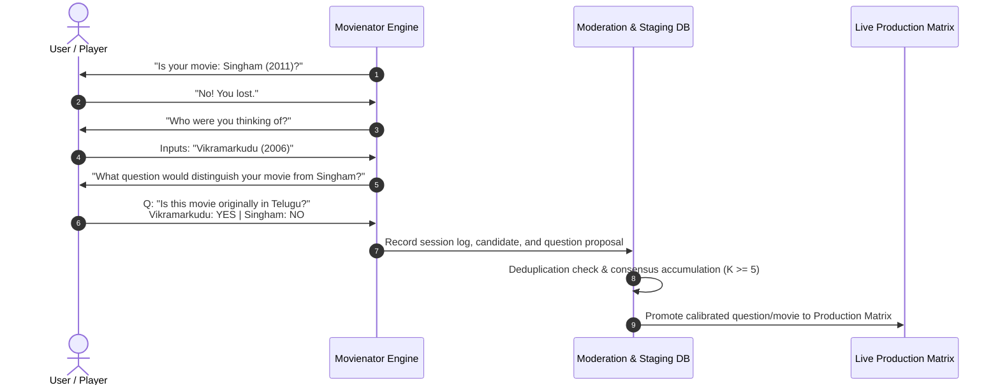

# Movienator: Crowdsourced Continuous Learning & Anti-Poisoning

## 1. Why Self-Learning is Essential

Akinator’s magic does not come from a massive team of developers hand-coding rules for decades. It comes from an **active crowdsourced feedback loop**:
* When the engine guesses correctly, it reinforces its beliefs.
* When the engine is defeated, it asks the player to teach it the right movie and provide a question that would have distinguished it.

Over millions of games, this organic loop transforms sparse data into an ultra-dense, self-healing knowledge graph.



---

## 2. The Defeat Workflow Step-by-Step

### Step 1: Disambiguation Search
When the player rejects the top guess, the UI prompts: *"What movie were you thinking of?"*
* An autocomplete search runs against the full master catalog (TMDb / IMDb / Wikidata).
* **Case A (Movie exists in database):** The failure occurred because the player answered unexpectedly or the movie's attribute weights were inaccurate. We recalibrate the movie's likelihoods based on this session's answers.
* **Case B (Novel Movie not in database):** The movie is a completely new entry. We ingest its basic metadata (Title, Year, Language, Director) and create a new row in the candidate matrix.

### Step 2: Distinguishing Question Creation
The engine asks the player:
> *"Help me get smarter! Please provide a Yes/No question that would be **YES** for [Your Movie], but **NO** for [My Guess]."*

The player inputs:
* `New Question Text`: *"Does the hero have an alter-ego lookalike who is a thief?"*
* `Answer for Target`: **YES**
* `Answer for Guess`: **NO**

---

## 3. Mathematical Matrix Expansion Rules

### 3.1 Case A: Recalibrating an Existing Movie
For all questions $Q_{(\tau)}$ asked during the session with player answers $a_{(\tau)}$:
$$N_{C^*, Q_{(\tau)}, a_{(\tau)}} \leftarrow N_{C^*, Q_{(\tau)}, a_{(\tau)}} + w_{\text{user}}$$
where $w_{\text{user}} \in [0.05, 1.0]$ is a trust weight.
The popularity prior count is incremented:
$$\text{Count}(C^*) \leftarrow \text{Count}(C^*) + 1$$

### 3.2 Case B: Ingesting a Novel Movie ($N \to N + 1$)
1. Candidate dimension expands: $C_{N+1} = \text{New Movie}$.
2. Initial popularity prior count: $\text{Count}(C_{N+1}) = 1$.
3. For questions asked during the defeat session, register the user's answers with extra weight:
   $$N_{N+1, Q_{(\tau)}, a_{(\tau)}} = 2 + \alpha$$
4. For all unasked questions, initialize an uninformative Dirichlet baseline:
   $$N_{N+1, Q, a} = \alpha \quad \forall a \in \mathcal{A} \quad (\text{yields uniform } 0.20 \text{ likelihood})$$

### 3.3 Case C: Adding a New Question Column ($M \to M + 1$)
1. Append new question $Q_{M+1}$ to the question pool.
2. Initialize column across all $N$ existing movies with uninformative counts ($\alpha$).
3. Explicitly reinforce the distinguishing answers:
   $$N_{C^*, Q_{M+1}, Y} \leftarrow 2 + \alpha$$
   $$N_{C_{\text{guess}}, Q_{M+1}, N} \leftarrow 2 + \alpha$$

---

## 4. Anti-Vandalism & Data Poisoning Defense

Allowing public players to inject data into a machine learning matrix exposes the system to trolling, vulgarity, and intentional poisoning (e.g. associating inappropriate tags with children's movies).

Movienator implements a **4-tier moderation shield**:

```
[ User Input ]
      │
      ▼
Tier 1: Profanity & Hate-Speech Lexicon Filter
      │ (Pass)
      ▼
Tier 2: Semantic Duplicate Detection (Embedding Cosine Similarity > 0.82)
      │ (Pass)
      ▼
Tier 3: The Quarantine / Staging Sandbox (Shadow Database)
      │ (Requires >= 5 independent player confirmations)
      ▼
Tier 4: Production Matrix Promotion (Gradual Dirichlet Assimilation)
```

### 1. Semantic Duplicate Detector
Players often submit questions that already exist under slightly different wording:
* Existing: *"Is the protagonist an undercover police officer?"*
* Proposed: *"Does the hero pretend to be a criminal while being a cop?"*

Before accepting a new question, compute its sentence embedding (e.g., using `sentence-transformers/all-MiniLM-L6-v2`):
$$\text{CosineSim}(\mathbf{e}_{\text{new}}, \mathbf{e}_{\text{existing}}) > 0.82$$
If a match is found, Movienator rejects the new question text and instead attaches the player's vote to the existing question ID!

### 2. The Quarantine Sandbox & Consensus Gate
No crowdsourced question or movie goes directly to the live game:
* It resides in a `staging_questions` table.
* In future games where candidate $C^*$ is in the top 10, the engine quietly asks the staged question as an experiment.
* **Promotion Criterion:** A question is promoted to production only if:
  $$\frac{\max_a N_{C^*, Q, a}}{\sum_{a'} N_{C^*, Q, a'}} \ge 0.75 \quad \text{with at least 5 independent user confirmations.}$$

### 3. User Trust Scoring ($w_{\text{user}}$)
* Anonymous users from temporary proxies: $w_{\text{user}} = 0.05$.
* Established players with high game completion rates: $w_{\text{user}} = 1.0$.
* Bounded Drift: No single game session can shift any probability in the likelihood tensor by more than $\Delta_{\max} = 0.05$.
